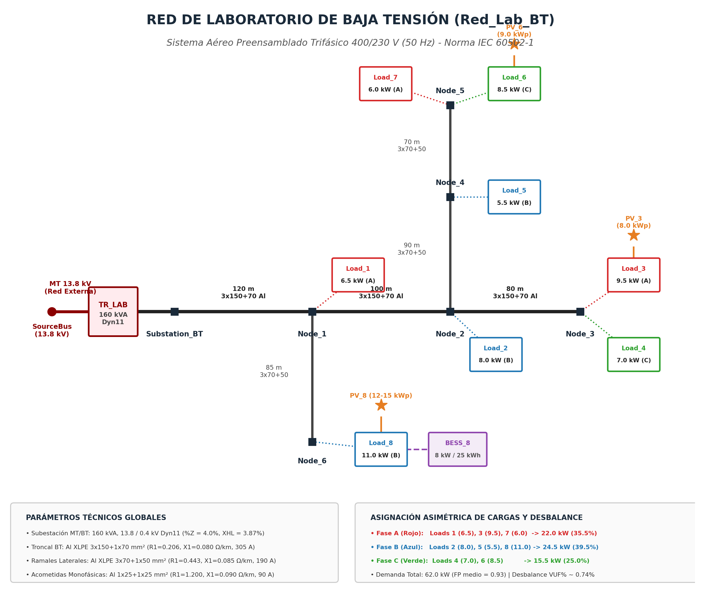

# OpenDSS-pyDSS-Lab ⚡
### Laboratorio Educativo Avanzado de Simulación y Análisis de Redes de Distribución Eléctrica con OpenDSS y Python (`py-dss-interface`)

<p align="center">
  
  
  
  
  
</p>

---

## 🌟 Visión General

**OpenDSS-pyDSS-Lab** es una plataforma docente y de investigación de código abierto desarrollada para enseñar y experimentar desde cero con la simulación moderna de redes eléctricas de distribución, análisis de calidad de potencia y la integración masiva de **Recursos Energéticos Distribuidos (DERs)**.

Inspirado en el trabajo educativo pionero del Prof. Nando Ochoa (`Team-Nando`) y el desarrollo de software de Paulo Radatz, este proyecto proporciona un currículo universitario completo que abarca desde la formulación nodal básica hasta el análisis probabilístico de **Capacidad de Alojamiento (*Hosting Capacity*)** mediante simulaciones de Monte Carlo y control inteligente de inversores (**IEEE 1547-2018**).

---

## 🗺️ Topología de la "Red Laboratorio BT"

Para los módulos analíticos y de control se diseñó una red radial trifásica asimétrica original basada en conductores preensamblados según norma **IEC 60502-1**:

<p align="center">
  
</p>

---

## 📚 Estructura Curricular del Laboratorio

El laboratorio está compuesto por **7 módulos progresivos** en formato Jupyter Notebook interactivo con celdas ejecutadas y gráficos pre-renderizados:

| Módulo | Cuaderno | Red de Prueba | Temas y Conceptos Clave |
|---|---|---|---|
| **0** | [`00_Fundamentos_pyDSS_OpenDSS.ipynb`](00_Fundamentos_pyDSS_OpenDSS.ipynb) | Red Laboratorio BT | Arquitectura C-API directa en memoria vs COM, objeto `DSS()`, formulación nodal $\mathbf{I}_{\text{iny}} = \mathbf{Y}_{\text{bus}} \mathbf{V}$, solución estática y navegación de objetos. |
| **1** | [`01_Modelado_Red_BT_Avanzada.ipynb`](01_Modelado_Red_BT_Avanzada.ipynb) | Red Laboratorio BT | Parámetros físicos de conductores aéreos preensamblados de Al XLPE (IEC 60502-1), impedancias de secuencia $Z_1, Z_0$, trafo Dyn11 de 160 kVA, flujo de neutro y rebalanceo de fases. |
| **2** | [`02_Extraccion_Analitica_Red.ipynb`](02_Extraccion_Analitica_Red.ipynb) | Red Laboratorio BT | Extracción en DataFrames, componentes simétricas de Fortescue ($V_0, V_+, V_-$), cálculo exacto de **$VUF\%$ según IEC 61000-4-30 / EN 50160**, comparación con NEMA PVUR y cargabilidad térmica (`NormAmps`). |
| **3** | [`03_Series_Temporales_y_QSTS.ipynb`](03_Series_Temporales_y_QSTS.ipynb) | LVcircuit (Benchmark) | Simulación Cuasi-Estática en el Tiempo (**QSTS**) de 24 horas (48 pasos de 30 min), envolvente de tensión ($V_{\max}, V_{\text{med}}, V_{\min}$), energía disipada ($kWh$), mapas de calor nodales (*Heatmaps*) y sensibilidad $\Delta V/\Delta P$. |
| **4** | [`04_Integracion_DERs_BESS_PV.ipynb`](04_Integracion_DERs_BESS_PV.ipynb) | Red Laboratorio BT | Elevación de tensión ($\Delta V \approx \frac{PR + QX}{V}$), modelado de sistemas fotovoltaicos (`PVSystem`), almacenamiento electroquímico (`Storage` - BESS), Estado de Carga ($SoC$) y *Peak Shaving*. |
| **5** | [`05_Control_Inteligente_Inversores.ipynb`](05_Control_Inteligente_Inversores.ipynb) | Red Laboratorio BT | Inversores inteligentes bajo norma **IEEE 1547-2018 / UL 1741-SB**, curvas autónomas **Volt-Var** ($Q(V)$) y **Volt-Watt** ($P(V)$), lazo iterativo de control en Python y minimización de recorte de energía (*Curtailment*). |
| **6** | [`06_Evaluacion_Monte_Carlo.ipynb`](06_Evaluacion_Monte_Carlo.ipynb) | Network-CRE21 (MT-BT) | Evaluación estocástica de **Capacidad de Alojamiento (Hosting Capacity)** con Monte Carlo masivo, dispersión espacial de adopción solar, diagramas de caja (*Boxplots*), percentil 95 ($HC_{95\%}$) y desbloqueo de capacidad con soporte inteligente. |

---

## 🔌 Redes de Distribución Empleadas

### 1. "Red Laboratorio BT" (Diseño Original para Módulos 0, 1, 2, 4 y 5)
Una red secundaria trifásica de 400/230 V alimentada por un transformador Dyn11 de 160 kVA (13.8 kV / 0.4 kV):
* **Troncal Principal:** Conductor preensamblado Al XLPE $3 \times 150 + 1 \times 70\text{ mm}^2$ ($R_1 = 0.206, X_1 = 0.080, R_0 = 0.820, X_0 = 0.095\ \Omega/\text{km}$, $I_{\text{nom}} = 305\text{ A}$).
* **Ramales Laterales:** Conductor preensamblado Al XLPE $3 \times 70 + 1 \times 50\text{ mm}^2$ ($R_1 = 0.443, X_1 = 0.085, R_0 = 1.450, X_0 = 0.100\ \Omega/\text{km}$, $I_{\text{nom}} = 190\text{ A}$).
* **Acometidas Domiciliarias:** Concéntrico $1 \times 25 + 1 \times 25\text{ mm}^2$ ($R_1 = 1.200, X_1 = 0.090, R_0 = 1.500, X_0 = 0.090\ \Omega/\text{km}$, $I_{\text{nom}} = 90\text{ A}$).
* **Cargas Asimétricas:** Distribución deliberadamente desbalanceada (Fase A: 22.0 kW, Fase B: 24.5 kW, Fase C: 15.5 kW; Total = 62.0 kW) para evidenciar corrientes de neutro y desbalance nodal.

### 2. "LVcircuit" (Módulo 3)
Circuito de baja tensión de referencia empírica con 55 viviendas residenciales monofásicas y perfiles diarios de demanda y generación solar con resolución de 30 minutos.

### 3. "Network-CRE21" (Módulo 6)
Alimentador real a gran escala de media y baja tensión:
* 7,489 barras nodales.
* 79 transformadores de distribución MT/BT.
* 3,374 usuarios monofásicos residenciales.

---

## 🧰 Toolkit Analítico Central (`utils/lab_dss_toolkit.py`)

El módulo `utils.lab_dss_toolkit` ofrece funciones de alto nivel para acelerar el análisis y la docencia:
```python
from utils.lab_dss_toolkit import (
    get_network_snapshot,
    calculate_vuf_iec,
    calculate_branch_loading,
    plot_voltage_profile,
    plot_unbalance_summary,
    plot_qsts_voltage_heatmap,
)

# Extraer estado consolidado en DataFrames
snapshot = get_network_snapshot(dss)
df_buses = snapshot["buses"]
df_lines = snapshot["lines"]

# Graficar perfil de tensión con límites normativos (ANSI / IEC)
fig = plot_voltage_profile(df_buses, v_min=0.95, v_max=1.05)
```

---

## 🛠️ Estructura del Repositorio

```text
OpenDSS-pyDSS-Lab/
├── README.md                                  <- Documentación principal con syllabus y diagramas
├── requirements.txt                           <- Dependencias del entorno Python
├── pyproject.toml                             <- Empaquetado estándar pip install -e .
├── LICENSE                                    <- Licencia MIT de código abierto
├── CITATION.cff                               <- Metadatos de citación académica
├── CONTRIBUTING.md                            <- Guía de contribución para estudiantes y colaboradores
├── .gitignore                                 <- Exclusiones de control de versiones
├── assets/
│   └── topology_red_lab_bt.png                <- Diagrama topológico de alta resolución
├── utils/
│   ├── __init__.py
│   └── lab_dss_toolkit.py                     <- Toolkit analítico (DataFrames, VUF IEC, gráficas)
├── data/
│   ├── circuit_lab_bt/                        <- Modelo OpenDSS de la Red Laboratorio BT
│   │   ├── Master_LabBT.dss
│   │   ├── Transformers_LabBT.dss
│   │   ├── LineCodes_LabBT.dss
│   │   ├── Lines_LabBT.dss
│   │   ├── ServiceDrops_LabBT.dss
│   │   ├── Loads_LabBT.dss
│   │   └── BusCoords_LabBT.dss
│   ├── circuit_lv/                            <- Circuito de referencia empírica LVcircuit
│   ├── network_cre21/                         <- Alimentador integrado a gran escala CRE21
│   └── profiles/                              <- Perfiles empíricos de demanda y radiación (.npy)
├── 00_Fundamentos_pyDSS_OpenDSS.ipynb
├── 01_Modelado_Red_BT_Avanzada.ipynb
├── 02_Extraccion_Analitica_Red.ipynb
├── 03_Series_Temporales_y_QSTS.ipynb
├── 04_Integracion_DERs_BESS_PV.ipynb
├── 05_Control_Inteligente_Inversores.ipynb
└── 06_Evaluacion_Monte_Carlo.ipynb
```

---

## 🚀 Instalación y Puesta en Marcha

### Prerrequisitos
* **Python 3.9 o superior** (probado en Windows, Linux y macOS).
* **Jupyter Notebook**, **JupyterLab** o **VS Code con extensión de Jupyter**.

### Pasos de Instalación
1. Clone el repositorio:
   ```bash
   git clone https://github.com/TU-USUARIO/OpenDSS-pyDSS-Lab.git
   cd OpenDSS-pyDSS-Lab
   ```

2. Cree y active un entorno virtual:
   ```bash
   python -m venv venv
   # En Windows:
   .\venv\Scripts\activate
   # En Linux / macOS:
   source venv/bin/activate
   ```

3. Instale las dependencias requeridas (y el toolkit en modo editable):
   ```bash
   pip install -r requirements.txt
   pip install -e .
   ```

4. Inicie Jupyter:
   ```bash
   jupyter notebook
   ```
   Abra el cuaderno `00_Fundamentos_pyDSS_OpenDSS.ipynb` para iniciar el laboratorio.

---

## 📖 Cita y Referencias Académicas
Si utiliza este material en cursos universitarios, capacitaciones técnicas o publicaciones de investigación, por favor cite:
```bibtex
@software{opendss_pydss_lab_2026,
  author = {OpenDSS-pyDSS-Lab Contributors},
  title = {OpenDSS-pyDSS-Lab: Advanced Educational Laboratory for Distribution System Analysis using OpenDSS and py-dss-interface},
  year = {2026},
  url = {https://github.com/TU-USUARIO/OpenDSS-pyDSS-Lab},
  license = {MIT}
}
```
* **EPRI (Electric Power Research Institute):** *Open Distribution System Simulator (OpenDSS)*.
* **Radatz, P.:** *py-dss-interface: A Python interface to the official OpenDSS C-API*.
* **Ochoa, L. F. et al. (Team-Nando):** *DER Hosting Capacity Educational Tutorials and Benchmark Networks*.
* **IEC 61000-4-30 / EN 50160:** *Power Quality Measurement Methods - Voltage Unbalance Factor (VUF)*.
* **IEEE Standard 1547-2018:** *IEEE Standard for Interconnection and Interoperability of Distributed Energy Resources with Associated Electric Power Systems Interfaces*.

---
Desarrollado con fines educativos y de investigación abierta para la comunidad de ingeniería eléctrica y sistemas de potencia.
